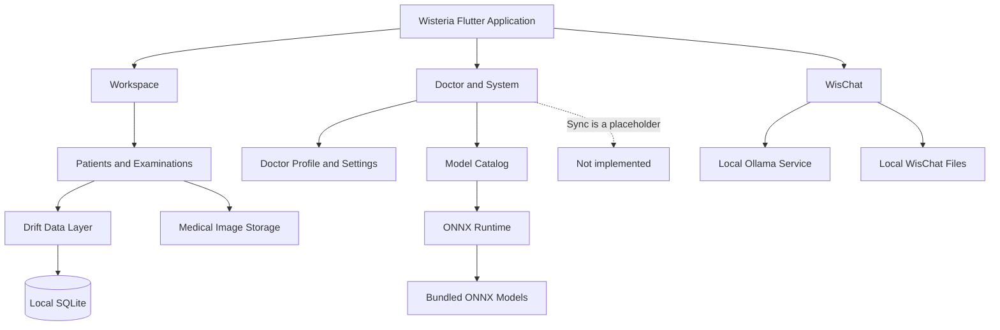

 <div align="center">


# 🌸 PROJECT WISTERIA

### *An Offline-First Clinical AI Workstation*

A doctor-centric desktop application for patient records, medical imaging, and AI-assisted clinical workflows.

[](https://flutter.dev/)
[](https://learn.microsoft.com/en-us/windows/)
[](https://drift.simonbinder.eu/)
[](https://onnxruntime.ai/)
[](https://github.com/FazilPRaphi/Wisteria)

</div>

---

 ## Overview

**Wisteria** is an offline-first, doctor-centric clinical desktop application for managing patient records, examinations, medical images, and locally run AI workflows.

Built with Flutter, Wisteria stores clinical records locally and offers two local AI workflows: image classification with bundled ONNX models and conversational assistance through a locally running Ollama service. Ollama and its selected model must be installed separately to use WisChat.

AI-generated findings are intended to support clinical review, not to diagnose, prescribe, or replace a healthcare professional's judgement.

 ## Key Features

| Feature | Description |
|---|---|
 | Patient records | Register, search, view, and edit patient demographic and clinical-history information. |
 | Examinations | Create examinations, add doctor notes and medical images, and review saved examination details. |
 | Local image classification | Run the bundled Pneumonia ResNet18 model on chest X-rays and Brain Tumor ResNet18 model on brain MRI images using ONNX Runtime. |
 | WisChat | Chat with a local Gemma 3 4B model through Ollama, with streamed responses, Markdown rendering, conversation history, saved memories, and draft persistence. |
 | Doctor profile and documents | Maintain professional and clinic details and view a saved doctor document. |
 | Models | View the preinstalled medical-model catalog and test supported image inference. |
 | Settings and themes | Switch between light and dark themes and view application/runtime information. |
 | Local data | Store clinical records in SQLite via Drift; WisChat conversations, memories, and drafts are stored separately in local application-support files. |
 | Synchronization | A Sync entry is visible in the interface, but synchronization is currently a placeholder and is not implemented. |

 > **Development note:** Wisteria is an academic project under active development. Eye and vision analysis is marked as coming soon; it is not currently a supported inference workflow.

 ## Interface Preview

Wisteria uses a desktop-first interface with three horizontally navigable work areas.

### Workspace

The Workspace screen provides quick access to:

- **New Patient** — register a new patient record.
- **Registered Patients** — browse, search, and open patient records, including their examination history.

### Doctor & System

A dedicated area groups the supporting application pages:

- Doctor Profile
- Settings
- Models
- Sync (placeholder)

### WisChat

WisChat is available as the third workspace tab. It sends chat requests to the local Ollama endpoint (`http://localhost:11434`) using `gemma3:4b` by default. Responses stream into the conversation and support Markdown formatting. Users can start and revisit conversations, save short memory items for inclusion in future prompts, and retain an unsent draft.

WisChat requires Ollama to be running with the configured model available. The app does not bundle the Gemma model; its initial download requires an internet connection.

### Light and Dark Themes

Wisteria supports a dark clinical interface (the default) and a light interface. Both themes share the same layout and use theme-aware colours for readable labels, descriptions, and actions.

 ## Design System

Wisteria uses a restrained clinical colour palette with navy surfaces, rose-pink accents, and teal-blue highlights.

### Dark Mode

| Colour | Hex | Usage |
|---|---|---|
 | Deep Navy | `#111923` | Main application background |
 | Dark Surface | `#1A2632` | Content surfaces |
 | Rose Pink | `#C998A2` | Accent and tint |
 | Teal Blue | `#098FA6` | Primary actions and informational highlights |
 | Soft White | `#F1F5F7` | Primary text |
 | Muted Blue-Gray | `#A6B5C0` | Secondary text |

### Light Mode

| Colour | Hex | Usage |
|---|---|---|
 | Soft Off-White | `#F0F5F6` | Main application background |
 | White Surface | `#FFFFFF` | Cards and content surfaces |
 | Rose Pink | `#C998A2` | Accent and tint |
 | Teal Blue | `#098FA6` | Primary actions and informational highlights |
 | Dark Navy | `#1E293B` | Primary text |
 | Muted Blue-Gray | `#5A6E7C` | Secondary text |

 *Palette values are defined in `lib/core/theme/wisteria_theme.dart`.*

### Design Principles

 - Clear navigation between the three workspace areas.
 - Relevant photographic assets for key sections.
 - Image-backed cards and restrained borders.
 - Consistent layouts across light and dark modes.
 - Minimal visual clutter, with colour used to establish hierarchy.

 ## Tech Stack

| Technology | Purpose |
|---|---|
| [Flutter](https://flutter.dev/) | Desktop application UI and framework |
| [Dart](https://dart.dev/) | Application programming language |
| [Drift](https://drift.simonbinder.eu/) | Typed database access and data management |
| [SQLite](https://sqlite.org/) | Local relational database |
| [ONNX Runtime](https://onnxruntime.ai/) | Local inference for the bundled image-classification models |
| [Ollama](https://ollama.com/) | Local LLM service used by WisChat |
| [flutter_markdown](https://pub.dev/packages/flutter_markdown) | Markdown rendering in WisChat |
| [PyTorch](https://pytorch.org/) | Model-development notebook workflow (not used for in-app inference) |
| [Git](https://git-scm.com/) | Version control |
| [GitHub](https://github.com/) | Source-code hosting and collaboration |

 ## Architecture Overview

The application separates the user interface, local data access, file storage, and AI services. Clinical records are managed through Drift and SQLite. WisChat uses Ollama on the local machine, while medical-image classification uses the bundled ONNX models.



 ## Project Structure

Key repository folders and files:

```text
Wisteria/
├── assets/
│   ├── images/
│   └── models/
│       ├── brain_tumor_resnet18.onnx
│       ├── pneumonia_resnet18.onnx
│       └── Wisteria - Brain Tumor ResNet18.ipynb
├── lib/
│   ├── core/       # Database, services, models, storage, and theme
│   └── features/   # Patient, examination, model, WisChat, and workspace UI
├── test/
├── android/ ios/ linux/ macos/ web/ windows/
├── pubspec.yaml
├── pubspec.lock
└── README.md
```

 ## Getting Started

### Prerequisites

For Windows desktop development, install:

- [Flutter SDK](https://docs.flutter.dev/get-started/install)
- [Git](https://git-scm.com/downloads)
- [Visual Studio](https://visualstudio.microsoft.com/) with the **Desktop development with C++** workload

Android Studio and the Android SDK are not required to run the Windows desktop version. WisChat additionally requires [Ollama](https://ollama.com/) and the `gemma3:4b` model; these are separate from the Flutter app.

### 1. Clone the Repository

```bash
git clone https://github.com/FazilPRaphi/Wisteria.git
cd Wisteria
```

### 2. Check Flutter Setup

```bash
flutter doctor
```

Resolve any issues related to the Windows desktop development toolchain.

### 3. Install Dependencies

```bash
flutter pub get
```

### 4. Run Wisteria

```bash
flutter run -d windows
```

### 5. Set up WisChat (Optional)

Install Ollama, then download the model used by WisChat:

```bash
ollama pull gemma3:4b
```

Make sure Ollama is running locally, then open the **WisChat** workspace tab. The model download is only needed once; subsequent chat requests are sent to the local Ollama service.

### 6. Run Tests

Run the Flutter widget tests:

```bash
flutter test test/widget_test.dart
```

The Ollama verification test uses a live local service and the `gemma3:4b` model:

```bash
flutter test test/offline_model_verification_test.dart
```

### 7. Optional: Regenerate Database Code

When database definitions change, regenerate the Drift code with:

```bash
dart run build_runner build --delete-conflicting-outputs
```

 ## Local Data Management

Wisteria uses SQLite with Drift to organise application data locally.

The Drift schema currently includes:

- Doctor profiles and patient records.
- Previous medical information, medications, and test results.
- Examinations, doctor notes, and medical-image metadata.
- Medical models, versions, inference runs, results, and findings.
- AI analysis, evidence, doctor-review, and final-report records.
- A synchronization queue table; a functioning synchronization workflow is not yet implemented.

Medical image files are managed in local storage. WisChat persists conversations, memories, the active conversation, and drafts as files in the operating system's application-support directory; these are separate from the clinical SQLite database.

 ## Privacy and Offline-First Approach

Wisteria is designed to support local workflows without continuous internet access after required software and models are installed.

 - Patient and examination data are stored in the local SQLite database.
 - Bundled ONNX models run image classification locally.
 - WisChat sends prompts to a local Ollama service; installing Ollama and downloading its model initially requires a network connection.
 - AI outputs should be independently reviewed by a qualified healthcare professional and must not be treated as a diagnosis.

**Important:** Offline operation does not by itself guarantee data security. Protect the device and its local files, use suitable access controls and backups, and do not use real patient data for testing or development.

 ## Contributing

Wisteria is developed collaboratively as an academic project.

To contribute:

1. Fork or clone the repository.
2. Create a separate branch for your changes.
3. Make and test your modifications.
4. Commit your changes with a descriptive message.
5. Push your branch to GitHub.
6. Open a pull request for review.

Please avoid committing patient-identifiable information, credentials, API keys, or other sensitive data.

 ## License

There is no `LICENSE` file in the repository at this time. License terms have not been specified; clarify them before redistributing or reusing the project.

---

<div align="center">

 **Built with care for offline-first clinical workflows**

🌸 *Project Wisteria — Bringing patient records and AI-assisted analysis together.*

</div>
